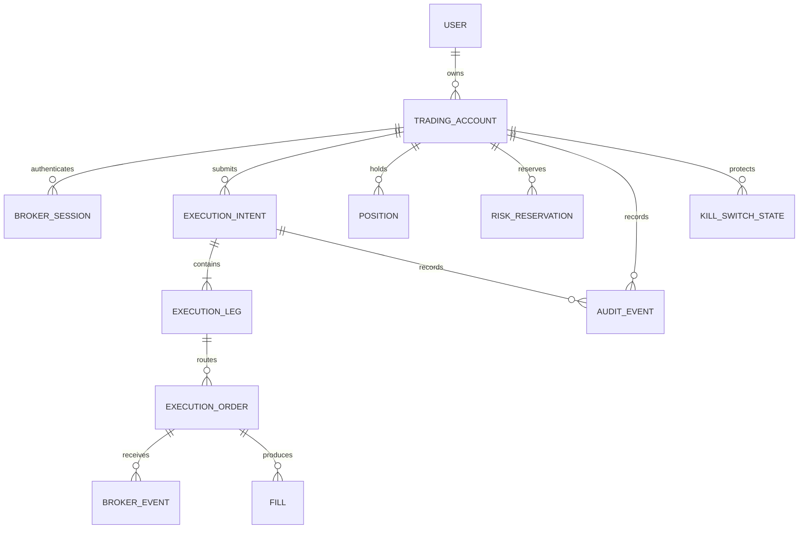
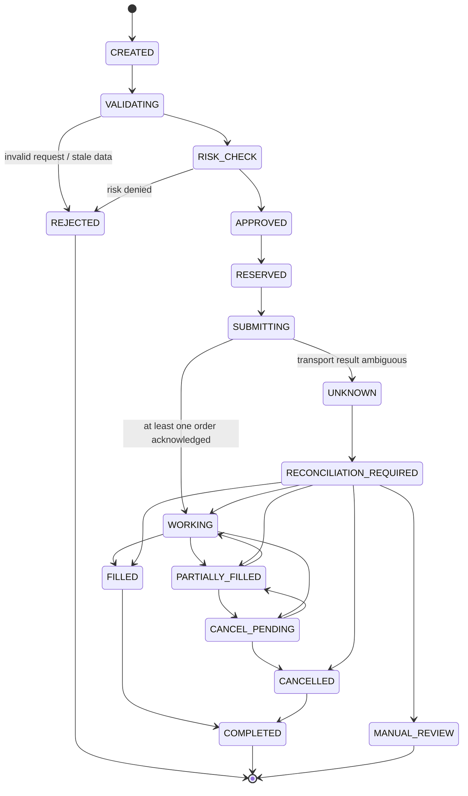

# Batch 0 — Target Architecture, State Machine, and Migration Plan

**Status:** Design proposal; not an implementation authorization.  
**Base audited:** `main` at `8da655f0c287251cf1602cae484714a7c26fcf15`.  
**Scope:** Unified Paper/Live execution core, multi-account broker ownership, durable recovery, mobile remote UI, and hosting transition.

## 1. Design invariants

1. Paper and Live use the same validation, risk, intent, leg coordination, normalized state transitions, event/audit, and recovery contracts.
2. Only the adapter at the final side-effect boundary differs: deterministic Paper simulator versus broker-specific Live transport.
3. Live remains fail-closed until account ownership, durable state, broker reconciliation, risk controls, and operational recovery pass the release gates.
4. No exchange-level atomicity is assumed for a four-leg order. A basket is an application-level coordination unit, not an atomic exchange transaction.
5. Every order, fill, position, risk reservation, idempotency key, and broker session is scoped to a stable trading account.
6. A broker trading session is not a market-data WebSocket. Execution work must not create or alter scanner subscriptions.
7. Existing Box Paper endpoints, ledger history, charges, and scanner-derived quotes remain compatible during migration.
8. No migration may silently convert legacy Paper rows into Live rows or attach them to an arbitrary broker account.

## 2. Proposed logical entity model

The following is a target logical model, not a claim that these tables already exist.

### Entity responsibilities and key constraints

| Entity | Responsibility | Required uniqueness / integrity |
|---|---|---|
| TradingAccount | Stable owner-scoped Paper or broker account | Unique `(user_id, account_id)`; broker identity unique per user only where broker semantics guarantee it; never assume one account per broker |
| BrokerCredentialRef | Pointer to encrypted secret material in a secrets store | No raw password, TOTP seed, API secret, or access token in ordinary DB columns/logs |
| BrokerSession | Per-account session metadata and expiry | Unique session identity; revocable; encrypted token reference; never shared across accounts |
| ExecutionIntent | Immutable user request and strategy snapshot | Unique `(account_id, idempotency_key)` |
| ExecutionLeg | One intended instrument/action/quantity within a basket | Unique `(intent_id, leg_key)`; basket quantity and leg quantity validated |
| ExecutionOrder | One broker submission attempt for one leg | Unique `(account_id, broker, broker_order_id)` when broker ID exists; client order ID unique per account |
| BrokerEvent | Append-only broker acknowledgement/update/rejection payload after redaction | Unique broker event identity when supplied; otherwise deduplicate with normalized event fingerprint |
| Fill | Immutable execution receipt | Unique `(account_id, broker, broker_fill_id)` when available; otherwise deterministic adapter receipt key |
| Position | Account-scoped net/open position | No cross-account aggregation in write path |
| RiskReservation | Funds/exposure reserved before submission | Unique active reservation per intent; released or reconciled idempotently |
| AuditEvent | Append-only state and operator action history | Correlation ID, actor, account, timestamp, previous/current state |
| KillSwitchState | User/account/global disarm state | Global and account scopes; fail-closed default |

Paper accounts should be first-class accounts with `mode=PAPER` and an internal simulator provider. Live accounts use `mode=LIVE` plus a supported broker and verified broker-side account fingerprint. Mode must be immutable for a given account row; changing mode means creating a different account.

### Compatibility with current schema

The inspected current schema has `trading_accounts` with an integer ID and a unique `user_id`, plus virtual-balance fields. Generic `orders` and `positions` have user IDs but no account foreign key. Broker session metadata is currently process-local and keyed by `(user_id, broker)`. This design therefore requires an expand-and-contract migration; it must not rename/drop these structures in the first migration.

Do not equate the current Box Paper `account_key` with a future `TradingAccount.id`. It is a caller-provided ledger partition under the Paper owner token, not a verified authenticated account identity.

## 3. Unified execution lifecycle

### Intent and basket lifecycle

The intent state is an aggregate of child leg/order states. Each leg has its own state and cumulative filled quantity. An intent cannot be labelled `FILLED` until every required leg reaches its target quantity and all fills are persisted. If any leg is rejected or remains uncertain, the basket must enter an explicit partial-exposure/reconciliation path rather than pretending that all legs filled together.

### State-transition rules

- State changes are compare-and-set updates under a DB transaction/row lock; every accepted transition appends an audit event.
- The idempotency key is created by the client or server once and is immutable. A retry returns the original intent/receipt; it never creates a second basket.
- Reserve risk/margin before the first external submission. A reservation must be idempotently released only after terminal reconciliation.
- Persist `SUBMITTING` and a deterministic client order ID before calling the broker. A network timeout after submission is `UNKNOWN`, not `REJECTED`.
- For `UNKNOWN`, query by client order ID / broker order ID and reconcile broker order book, trades, and positions before retrying. If the broker cannot prove absence, do not blindly resubmit.
- Persist broker events before acknowledging them to downstream consumers. Event processing is idempotent and ordered per broker order where sequence/version data exists.
- Fill corrections, trade busts, and duplicate callbacks are separate append-only events; never mutate historical fill facts silently.
- Terminal intent state does not erase residual positions. Any unhedged residual exposure remains visible and risk-managed until reconciled/closed.

## 4. Multi-leg coordination and partial-fill policy

The coordinator submits legs using deterministic per-leg client IDs and records each broker acknowledgement. It does not promise atomic multi-leg execution.

Required policy:
1. Validate identical intended basket quantity and instrument/contract identity before approval.
2. Check fresh market depth and price collars at decision time; recheck immediately before each submission where possible.
3. Submit under a bounded concurrency policy configurable per broker. Do not assume parallel requests are always safer than sequential submission.
4. Track every leg's accepted, rejected, filled, and remaining quantities.
5. If a leg rejects or a timeout makes its status unknown, stop submitting unsent legs unless the configured recovery policy explicitly allows continuation.
6. Attempt cancellation only for confirmed open orders. Cancellation acknowledgement is not a fill; reconcile final traded quantity after cancel.
7. If residual exposure remains, apply a pre-approved recovery policy: retry within bounded price/time limits, hedge/close residual legs, or stop and require operator review. Never invent a hedge or exceed account risk caps.
8. Do not auto-replay a basket after process restart until broker-side order/trade/position reconciliation proves the exact outstanding state.

Paper uses the same coordinator and state transitions but a deterministic simulator. The simulator records fills through the same normalized fill interface and cannot call a broker adapter. Paper execution must remain explicitly labelled `PAPER_ONLY`.

## 5. Broker adapter contract

The current adapter protocol exposes connect, place, cancel, and disconnect only. The target contract should be typed and account-scoped:

- `authenticate(credentials_ref, challenge)` / `refresh_session()` / `revoke_session()`
- `place_order(account, client_order_id, normalized_order)`
- `modify_order(account, broker_order_id, changes)`
- `cancel_order(account, broker_order_id)`
- `get_order(account, broker_order_id | client_order_id)`
- `list_orders(account, since)` and `list_trades(account, since)`
- `get_positions(account)`, `get_funds(account)`, `get_margin(account, proposed_orders)`
- `stream_order_updates(account)` or a documented polling fallback
- `health_check(account)` and `reconcile(account, checkpoint)`

Every adapter must declare supported order types, products, exchanges, quantity/price constraints, client-order-ID support, update delivery semantics, rate limits, and reconciliation capabilities. Unsupported capabilities must fail explicitly rather than being silently emulated.

Registry keys identify broker providers; adapter instances/session handles identify individual account connections. A single provider adapter definition can serve many isolated account sessions. Never keep one mutable SDK client shared across accounts.

## 6. Paper route and ledger compatibility

The current Box Paper flow already has valuable controls: server-side fresh opportunity/depth checks; browser reference prices are not trusted; durable entry claims; atomic four-leg entry/exit ledger writes; stable fill IDs; idempotent exit receipt replay; read-only recovery; and no broker order routing.

The key mismatch is that intent/fill progress remains process-local while the ledger is durable. A crash after the durable claim but before the ledger commit leaves an ambiguous claim that currently requires manual review. The target lifecycle should preserve that fail-safe behavior until it can resolve ambiguity from durable execution records.

Migration requirements:
- Keep current Paper routes and response shapes working during the transition.
- Treat existing Paper ledger tables and charge calculations as source-of-truth history; do not recalculate old trades using new fee logic.
- Add an adapter around the existing Paper engine/ledger first; do not replace the ledger in one step.
- Make new normalized intent/order/fill rows reference the legacy trade ID during dual-write.
- Compare normalized totals, per-leg quantities, cash deltas, fees, and trade status against legacy ledger outputs.
- Keep expiry settlement disabled until trusted server-side official settlement inputs are available.
- Preserve the current read-only recovery default. Automatic replay requires a separately tested reconciliation proof.

## 7. Expand-and-contract database migration plan

No schema migration is included in this design document. The future implementation should use ordered, reversible migrations:

**M0 — Inventory and snapshot**
- Record current DB engine/version, table sizes, indexes, constraints, and migration head.
- Take and verify a restorable backup.
- Capture row counts and checksums for trading accounts, orders, positions, Box Paper accounts/trades/fills/ledger entries, and broker owner state.

**M1 — Additive account identity**
- Add nullable stable `account_id` references to generic order/position and new execution tables.
- Add TradingAccount provider, broker account fingerprint, lifecycle, and mode metadata using nullable/default-safe columns.
- Create new account/session/intent/leg/order/event/fill/risk/audit tables and indexes.
- Keep all legacy endpoints writing the old fields while compatibility code dual-writes only where the mapping is unambiguous.

**M2 — Explicit legacy attribution**
- Create a dedicated legacy Paper account per existing user only where ownership can be proven.
- For Box Paper ledger partitions, preserve `account_key` and create a mapping table with unique `(legacy_owner_scope, account_key)`; do not merge distinct keys.
- Legacy rows without reliable user/account ownership remain marked `LEGACY_UNATTRIBUTED` and read-only until reviewed.
- Do not fabricate broker accounts or convert legacy Paper rows into Live accounts.

**M3 — Dual-read/compare**
- Read legacy and normalized state in shadow mode.
- Compare counts, quantities, order status, realized P&L, fees, cash ledger, and open positions.
- Alert and block cutover on any unexplained mismatch.

**M4 — Controlled write cutover**
- Enable normalized writes behind a server-side feature flag for Paper only.
- Keep legacy ledger as compatibility/audit source until soak period and rollback criteria pass.
- Live order routing remains disabled.

**M5 — Live account onboarding (later release, separate approval)**
- Enable broker-specific account creation only after secrets handling, account isolation, session refresh, reconciliation, and kill-switch tests pass.
- Require explicit account-level risk limits and a verified broker account fingerprint.
- Roll out one broker and one test account at a time in a non-production or broker-approved test environment.

**M6 — Contract cleanup (last)**
- Remove obsolete uniqueness and legacy columns only after all data is attributed, all clients migrated, and restore/rollback rehearsal passes.
- Never perform destructive cleanup in the same release as first normalized execution.

Rollback: disable the new feature flag, return reads/writes to the legacy path, retain additive tables for diagnosis, and restore from backup only under an approved recovery procedure. Do not reverse a migration by dropping tables containing newly written execution facts.

## 8. Risk, authorization, and kill-switch model

- Authorization is checked against authenticated user ownership and the selected account on every request; opaque account IDs are not authorization.
- Secrets are stored only through an encrypted secret manager/reference layer with rotation and revocation. Never log credentials, TOTP, access tokens, or full broker responses containing secrets.
- Risk checks include account and user aggregate limits, daily loss, open positions, gross/net exposure, available funds/margin, instrument/expiry eligibility, stale quotes, price collars, lot multiples, broker rate limits, and duplicate intent detection.
- A global kill switch, per-user switch, and per-account switch are independently persisted. Missing/unavailable switch state means disarmed.
- Disable/kill operations must take effect locally before attempting durable confirmation, and failure to persist must be surfaced as an operational incident.
- Live enablement requires two-step explicit operator action and a readiness report; no API call in this batch may arm Live.

## 9. Event transport and scanner isolation

Market-data ingestion and execution order updates are separate planes.

- Preserve the existing shared common market-data manager, Box live WebSocket, IV scanner consumers, and page-push channels.
- Do not subscribe the execution engine to market-data tokens independently. Consume the existing server-side quote/depth snapshot interface with freshness metadata.
- Execution events use a distinct event namespace and account-scoped authorization; they must not be broadcast to public page channels.
- Current page-push fanout is process-local. Keep one API worker until a shared transport is deployed and sequence/resync semantics are tested.
- Before multi-worker deployment, use a durable event log/outbox plus Redis Streams, PostgreSQL-backed queue, or another verified shared transport. Select one only after load/failure testing; do not introduce a second market-data WebSocket.
- A browser/mobile reconnect must be able to request a snapshot and resume from a sequence cursor without missing fills or exposing another account's events.

## 10. Android remote UI architecture

Keep the native Kotlin shell responsible for authentication, secure token storage, device-level capabilities, push lifecycle, and safety-critical confirmations. Serve routine page composition remotely through a signed, versioned manifest.

Manifest contract:
- schema version, app minimum version, page ID, route, content version, capability allowlist, API contract version, expiry, and signature.
- Remote content may select only preinstalled/supported UI components and API capabilities; no arbitrary remote executable code.
- ETag/version checks avoid repeated downloads; page updates invalidate only the affected cache.
- Cache last-known-good manifest/content; reject invalid signatures, expired manifests, unsupported schema versions, and rollback to last-known-good.
- Native-only changes (permissions, SDK, new device capabilities) still require APK release.
- Store refreshable auth material in Android Keystore-backed encrypted storage; never persist broker credentials or TOTP seeds in the client.
- Use a lifecycle-aware push channel for update notifications, not five-second polling for every page. Keep a safe polling fallback and respect battery/network constraints.
- Live enable/disable and kill-switch confirmations remain native/server-enforced and cannot be overridden by remote page content.

## 11. VPS + Cloudflare hosting transition

Vercel remains the rollback target until all gates pass. The current VPS workflow's SSH timeout had no remote-start marker, so remote state must be inspected before retrying deployment.

Target topology:
- Cloudflare DNS/proxy/WAF/TLS at the edge.
- VPS frontend service and FastAPI service as separate supervised processes/containers.
- Reverse proxy routes HTTPS API and WebSocket paths to the correct service with explicit upgrade/timeout settings.
- PostgreSQL and durable event transport are private-network services with backups and restore drills.
- Health endpoints distinguish process liveness, readiness (DB/migrations/secrets), and dependency health.
- Deployment uses an exclusive lock and durable job ID; remote work writes timestamped logs/status before returning control to SSH. A disconnected client can query the existing job instead of starting another.
- Deploy immutable commit SHA, run preflight, apply additive migrations, health-check, then switch traffic. Rollback restores previous app artifact/config; schema rollback remains backward-compatible.
- Do not expose DB, Redis, broker secrets, or admin endpoints publicly.

Cutover sequence:
1. Verify VPS state and deployment runner; repair observability first.
2. Deploy frontend/API to staging hostname.
3. Verify TLS, auth, CORS, REST, WebSocket, mobile compatibility, backups, and rollback.
4. Replay production-like load and scanner feed without changing current production subscriptions.
5. Run shadow/read-only checks against the new path.
6. Switch a small controlled traffic cohort; monitor error rate, latency, event lag, reconnects, and scanner freshness.
7. Keep Vercel DNS/deployment and previous VPS artifact ready for immediate rollback.
8. Decommission Vercel only after a defined stable soak period and explicit approval.

## 12. Test and release matrix

| Area | Required tests before Paper cutover | Additional tests before Live |
|---|---|---|
| Intent/idempotency | Duplicate API retry returns same intent and fills | Duplicate broker submission prevented after ambiguous timeout |
| Multi-leg | Unequal leg quantity rejected; partial fill/reject recovery simulated | Broker partial fill, cancel race, unknown status, residual exposure reconciliation |
| Paper isolation | Simulator cannot invoke broker adapter; ledger totals match legacy | N/A |
| Accounts | Two Paper accounts for same user isolated | Two accounts at same broker and accounts across brokers isolated |
| Broker session | Mock session refresh/revoke and process restart | Real adapter order/trade/position reconciliation per broker |
| Risk | Stale depth, invalid lot, limit collar, max exposure rejected | Funds/margin, daily loss, rate-limit and kill-switch under live broker state |
| Database | PostgreSQL migrations, concurrent idempotency, rollback rehearsal | Failover/restart during active broker orders |
| Scanner regression | Existing Box/IV API, ticks, channels, subscriptions unchanged | Same; no execution-triggered socket fanout |
| Android | Auth restore, manifest signature/cache/rollback, old app fallback | Native safety confirmation and account isolation |
| Hosting | VPS staging REST/WS/TLS/health/rollback | Production soak, alerting, restore drill |

## 13. Explicit non-goals for Batch 0

- No live broker order placement.
- No scanner strategy, signal formula, subscription, or market-data WebSocket change.
- No removal of Vercel or production DNS cutover.
- No destructive schema migration.
- No automatic replay of ambiguous orders or paper claims.
- No remote arbitrary code execution in Android.
- No claim of exchange-level atomic four-leg fills.

## 14. Design acceptance checklist

- [ ] Existing schema and legacy Paper ownership mapping reviewed against a real backup.
- [ ] Exact current Paper entry/exit/settlement crash boundaries verified by tests.
- [ ] All runtime callers of the existing execution package inventoried.
- [ ] Adapter capability matrix completed for Angel One, Fyers, Shoonya, mStock, and Zerodha before claiming support.
- [ ] PostgreSQL concurrency and migration/restore rehearsals pass.
- [ ] Scanner/WebSocket regression baseline captured from runtime, not inferred from repository.
- [ ] Android manifest signing and native auth lifecycle threat model reviewed.
- [ ] VPS deployment job/lock/status mechanism tested without risking production.
- [ ] Separate implementation PR reviewed; Live remains disabled by default.

**Decision:** This target design is a reviewable blueprint. It does not authorize enabling Live, changing production routing, changing scanner sockets, or cutting over hosting.
